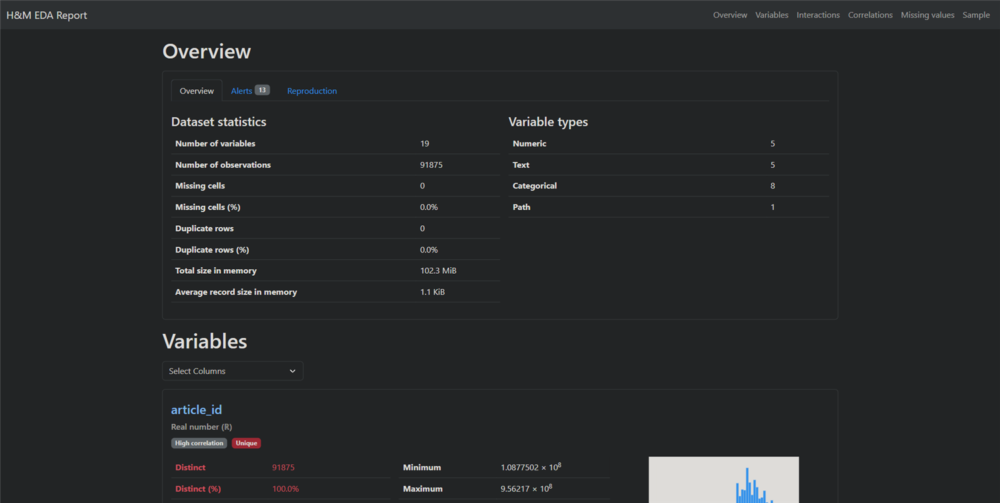

# H&M Price Prediction

A small ML project: predict the price of H&M items from product data, text and photos.

This is a learning project, not a production service. I wanted to compare a classic gradient boosting model with a multimodal neural network on the same data.

## What is inside

- Building a local analytical database with DuckDB from the H&M CSV files.
- Preprocessing: numeric features, categorical features, text descriptions and image paths.
- CatBoost regression as the main model.
- A PyTorch model that combines an EfficientNet image branch with tabular features.
- An EDA report generated in HTML.

## Result

| Model | R2 |
|---|---|
| CatBoost (tabular + text) | 0.8097 |
| PyTorch multimodal | lower than CatBoost |

CatBoost turned out to be better and much faster to train. The neural network needed more time and did not beat it, so the saved model in the repo is CatBoost.



## Data

The dataset is not included. Download the H&M competition data from Kaggle and put the CSV files and images where `src/config.py` expects them.

`data/DOWNLOAD_DATASET_PHOTOS.txt` contains the short note about images.

## Project structure

```
sql/                  SQL scripts and a small script that creates the DuckDB database
src/Analyze_data/     loading features and the HTML EDA report
src/Preprocessor/     sklearn preprocessing pipeline
src/Models/CatBoost/  CatBoost training and saved model
src/Models/PyTorch/   multimodal PyTorch model
```

## How to run

```bash
pip install -r requirements.txt
python sql/create_db.py
```

Then run the model script from `src/Models/CatBoost/` or `src/Models/PyTorch/`.

The code expects the database and image folder to exist. Without the Kaggle data the scripts will not run.

## Notes

- The EDA HTML report in this repo was generated on the full dataset.
- The saved `catboost_best_model.cbm` is the model I used for the final check.
- Image paths in the dataset point to files that are not in the repository.
